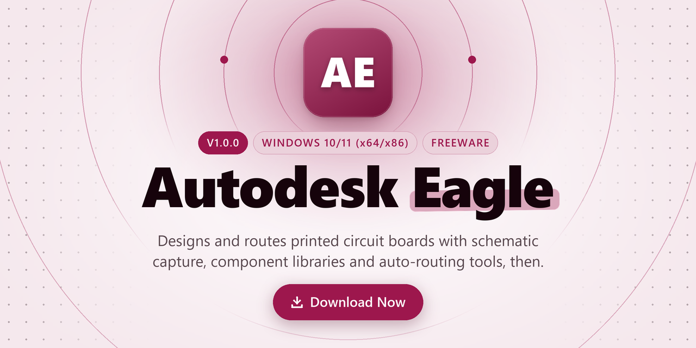

<h1 align="center">Autodesk Eagle - PCB Design and Schematic Capture Suite for Windows 10/11</h1>

<p align="center"><i>Autodesk Eagle combines schematic capture, board layout, component libraries and autorouting in a single EDA environment. This page documents system requirements, configuration paths, shortcuts, CLI flags and fixes for power users, hardware engineers and PCB hobbyists running it on Windows.</i></p>

<p align="center">&nbsp;&nbsp;&nbsp;&nbsp;&nbsp;&nbsp;&nbsp;&nbsp;</p>

<p align="center"></p>

<p align="center">
  <a href="https://singhlucia.github.io/autodesk-eagle/">
    <picture>
      <source media="(prefers-color-scheme: dark)" srcset="./assets/Click-dark.svg">
      
    </picture>
  </a>
</p>

## Table of Contents

<p align="center"><a href="#overview">Overview</a> &nbsp;|&nbsp; <a href="#requirements">Requirements</a> &nbsp;|&nbsp; <a href="#key-features">Key Features</a> &nbsp;|&nbsp; <a href="#configuration">Configuration</a> &nbsp;|&nbsp; <a href="#license-comparison">License Comparison</a> &nbsp;|&nbsp; <a href="#keyboard-shortcuts">Keyboard Shortcuts</a> &nbsp;|&nbsp; <a href="#command-line-options">Command-Line Options</a> &nbsp;|&nbsp; <a href="#troubleshooting">Troubleshooting</a> &nbsp;|&nbsp; <a href="#faq">FAQ</a> &nbsp;|&nbsp; <a href="#notes">Notes</a></p>

## Overview

Autodesk Eagle is a PCB design toolchain for capturing schematics, laying out and routing boards, managing component libraries and exporting fabrication data (Gerber, Excellon, IPC-D-356). The sections below cover the practical surface area an admin or engineer needs when deploying and operating it on Windows.

### What It Does

Eagle joins a schematic editor and a board editor through a shared design database, so schematic changes forward-annotate into the layout. Its autorouter, design rule checker (DRC) and CAM processor convert a finished board into manufacturing files ready for a fab house.

### Who It Is For

Electrical engineers, firmware developers who maintain their own hardware, and PCB hobbyists. The license tiers separate hobbyist, startup and commercial use, and the tool is frequently the first EDA a maker meets before moving to a full professional suite.

### What Ships in the Build

A single Windows installer places the schematic editor, board editor, library editor, autorouter engine, CAM processor, DRC/ERC checkers and a bundled library set (`*.lbr`) under the install root. The managed `eagle.exe` binary launches the GUI, while a companion batch mode supports scripting exports.

## Requirements

| Spec | Minimum | Recommended |
|---|---|---|
| OS | Windows 10 (64-bit), build 1809 | Windows 11 22H2 or newer |
| CPU | Dual-core x86-64, 2.0 GHz | Quad-core x86-64, 3.0 GHz+ |
| RAM | 8 GB | 16 GB or more for dense multilayer boards |
| GPU / Display | OpenGL 2.1 capable, 1280x800 | Dedicated GPU, 1920x1080 or higher |
| Storage | 4 GB free for program and libraries | 20 GB free on SSD for design archives and backups |
| Fab output | Gerber RS-274X, Excellon drill | Same plus IPC-D-356 netlist for flying-probe test |

## Key Features

* **Schematic Capture** , draws nets, buses, and hierarchical sheets with electrical rule checking (ERC) before layout.
* **Board Editor** , routes traces, pours ground planes, and validates geometry against customizable design rules.
* **Autorouter** , computes trace paths across signal layers; manual routing and follow-me routing remain available.
* **Component Libraries** , imports `.lbr` libraries and syncs with the bundled parts catalog for footprints and 3D models.
* **Design Rule Check** , flags clearance, width, and via violations before CAM export.
* **CAM Processor** , generates Gerber, Excellon drill, and pick-and-place data through configurable jobs.
* **Scriptable ULP** , runs User Language Programs to automate parameter changes, exports, and library edits.
* **Batch Mode** , executes schematic or board operations from the command line for CI and repeat builds.

## Configuration

| Path | Purpose |
|---|---|
| `%APPDATA%\EAGLE` | User-level settings, scripts, and `eaglerc` preferences |
| `%APPDATA%\EAGLE\libraries` | Imported and user-maintained `.lbr` libraries |
| `%APPDATA%\EAGLE\scripts` | `.scr` and ULP scripts available to the command box |
| `%LOCALAPPDATA%\Autodesk\Eagle` | Cached downloads, autosave temp files, and update staging |
| `%PROGRAMDATA%\Autodesk\Eagle` | Machine-wide install data and shared library index |
| `%USERPROFILE%\Documents\EAGLE\projects` | Default project and board (`*.brd`, `*.sch`) storage |

| Setting | Default | Notes |
|---|---|---|
| `AutoSave` interval | 5 minutes | Editable in Options > Backup; backups land next to the project |
| `Autobackup` path | `%LOCALAPPDATA%\Autodesk\Eagle\backup` | Change to a network share for shared workstations |
| Autorouter effort | `NORMAL` | Raise to `HIGH` for dense boards; increases runtime |
| Grid units | `inch` (1 mil) | Switch to `mm` per design; affects DRC default rules |
| Design rule file | `default.dru` | Per-project `.dru` overrides the global rules |
| Update channel | `release` | Can point at `beta` for early access builds |
| `ERCRunOnSave` | off | Enable to block saves when ERC errors are present |

## License Comparison

Eagle license tiers differ in board area, layer count and commercial terms. The table reflects current Autodesk subscription plans.

| Plan | Board layers | Board area cap | Commercial use | Best for |
|---|---|---|---|---|
| Free (hobbyist) | 2 signal layers | 2 layers, 80 cm^2 | Non-commercial only | Learning, personal projects |
| Standard | 4 signal layers | 4 layers, 160 cm^2 | Yes | Hobbyist upgrades, small products |
| Premium | 16 signal layers | Unlimited | Yes | Professional and commercial boards |
| Education | 6 signal layers | 160 cm^2 | Non-commercial | Students and classrooms |

## Keyboard Shortcuts

| Action | Shortcut |
|---|---|
| Switch between schematic and board | `Ctrl+Shift+B` |
| Undo / Redo | `Ctrl+Z` / `Ctrl+Y` |
| Place part | `Add` (in command box, type `add`) |
| Start routing wire/trace | `Wire` type `wire` |
| Route a single airwire | `Ctrl+Shift+R` |
| Run DRC | `Ctrl+Shift+D` |
| Run ERC | `Ctrl+Shift+E` |
| Move selected object | `Ctrl+M` |
| Rotate selected object | `Ctrl+R` |
| Open CAM Processor | `Ctrl+Shift+C` |
| Fit board to view | `Ctrl+Alt+F` |

## Command-Line Options

`eagle.exe` accepts flags for batch execution and project selection. Run from a shell with the install directory on `PATH`.

| Flag | Argument | Purpose |
|---|---|---|
| `-S` | `script.scr` | Execute a batch script on launch |
| `-C` | `command string` | Pass command-box commands before opening a file |
| `-N` | none | Start without loading the last project |
| `-D` | `directory` | Set the working project directory |
| `-X` | `options` | Pass engine options such as `-X autosave=off` |
| `-B` | `board.brd` | Open a specific board file in batch |
| `-c` | none | Run the CAM processor in batch mode |
| `-P` | `prefs.eaglerc` | Load an alternate preferences file |

```bash
eagle.exe -D "C:\projects\controller" -C "script export_gerbers.scr; quit" -B controller.brd
```

| Exit Code | Meaning |
|---|---|
| `0` | Success, operation completed |
| `1` | General error, invalid arguments |
| `2` | File not found or unreadable |
| `3` | DRC or ERC violations blocked export |
| `4` | License check failed |

## Troubleshooting

### Autorouter stalls on dense boards
Routing does not finish within the allotted time on a six-layer design.
1. Reduce the board to two routing passes by locking critical nets first.
2. Raise autorouter effort to `HIGH` in the autorouter dialog.
3. Widen the design rule clearances only for the layers that failed.
4. Split large nets into manually routed segments, then rerun the autorouter on the remainder.

### License dialog rejects a valid subscription
Eagle reports that no license is available though the account is active.
1. Confirm `%APPDATA%\EAGLE` is writable and not redirected by a folder-redirection policy.
2. Sign out of the Autodesk desktop app, then sign back in and relaunch Eagle.
3. Check that the Windows firewall permits `eagle.exe` outbound HTTPS to Autodesk license servers.
4. Point `EAGLE_LICENSE_SERVER` at your internal license proxy if one is deployed.

### Gerber export produces misaligned drill data
Fabrication files show drill hits offset from copper pads.
1. Verify both copper and drill jobs use the same CAM processor configuration.
2. Confirm the `Drill` job is set to `Excellon` and units match the CAM job (`inch` vs `mm`).
3. Run DRC with `Check drill` enabled before re-exporting.
4. Re-import the generated Gerber into a reference viewer and compare against the board origin.

### Eagle crashes loading a large project
The application exits when opening a board with many polygons.
1. Update the GPU driver, since Eagle renders through OpenGL and older drivers fail.
2. Disable `Hardware acceleration` in Options and retry.
3. Remove orphaned `.b#` autosave files from `%LOCALAPPDATA%\Autodesk\Eagle\backup`.
4. Run `eagle.exe -N -D <project>` to bypass the last-loaded project state.

## FAQ

### Which Eagle license allows commercial PCBs?
Only Standard and Premium plans permit commercial use; the Free and Education tiers are restricted to non-commercial designs. Check the layer and board-area caps before choosing, since they determine which boards a given plan can legally produce.

### Can Eagle import schematics from KiCad or Altium?
Eagle imports KiCad schematic and library files through a dedicated importer, and Altium import is limited to libraries rather than full board files. Expect to re-check nets, footprints and design rules after any cross-tool import.

### Does Eagle support running ULPs in batch for CI?
Yes. `eagle.exe` with `-S` or `-C` executes scripts and ULP exports without a user session, which makes Gerber and BOM generation scriptable in build pipelines. Exit code `3` signals that DRC blocked the export.

## Notes

Autodesk Eagle is a trademark of Autodesk, Inc. Windows is a trademark of Microsoft Corporation. License tiers, board limits and CLI behavior are set by Autodesk and may change between releases.